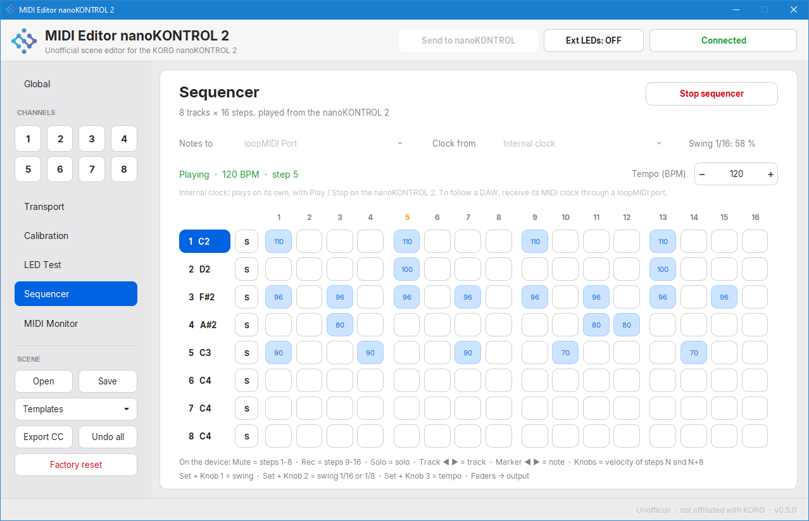

# MIDI Editor nanoKONTROL 2

Unofficial scene editor for the KORG nanoKONTROL 2 (Windows). Not affiliated with KORG.
It talks to the controller over USB MIDI (SysEx) and needs no driver beyond the one Windows already uses.



## Features
- Edit every assignment: type (CC / Note), number, min / max (or off / on) and behaviour, for 8 strips plus the transport section.
- **Calibration** page: Min / Max range of every fader and knob with draggable handles, invert, live position and the range actually measured from the hardware.
- MIDI Learn, live activity indicators, CC conflict warnings and a MIDI monitor.
- LED test for External LED mode, custom DAW assign slots, templates, copy strip to strips.
- Open / save presets (`.json`, `.syx`), export a CSV overview, undo all, factory reset.
- **Sequencer**: 8 tracks × 16 steps played from the device (Mute / Rec rows = steps, Solo = solo, Track ◀ ▶ = track, Marker ◀ ▶ = note, knobs = step velocity, Set + knob 1 = swing, Set + knob 2 = swing on 1/16 or 1/8), clocked by your DAW through two loopMIDI ports; faders keep going to the DAW.
- English and Spanish, following your Windows language.
- Fast, anti-aliased interface drawn on plain Tk canvases.

## Download
Get `MIDI-Editor-nanoKONTROL2.exe` from the [latest release](../../releases/latest). No installation needed.
Close other programs that use the nanoKONTROL 2 (DAWs, other editors) before opening it.

## Run from source
```
pip install -r requirements.txt
python main.py
```
Run the tests with `python -m unittest discover -s tests`.

## License
MIT, see [LICENSE](LICENSE).
